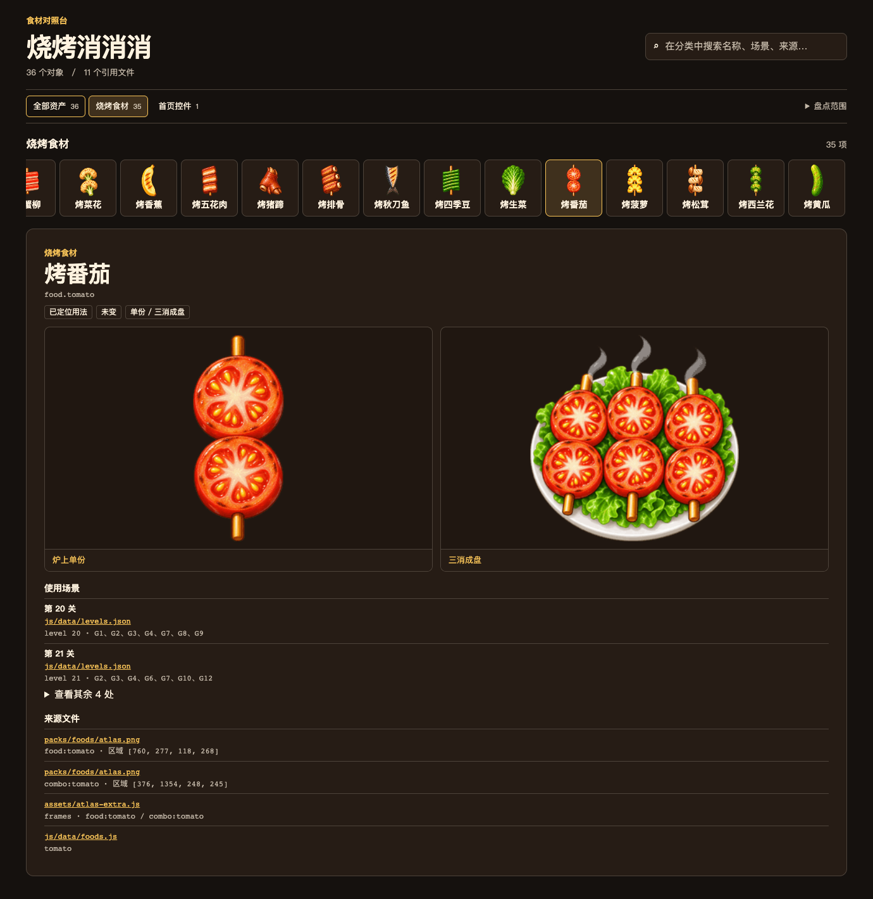
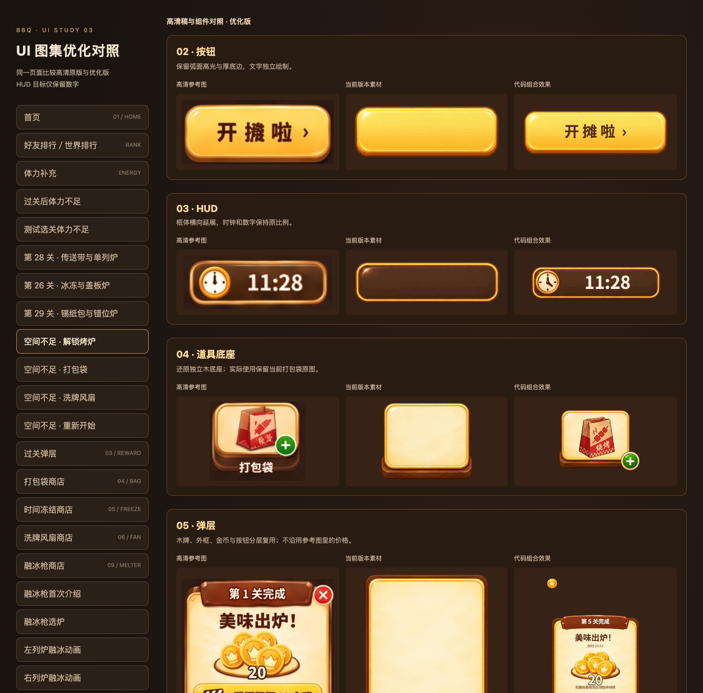
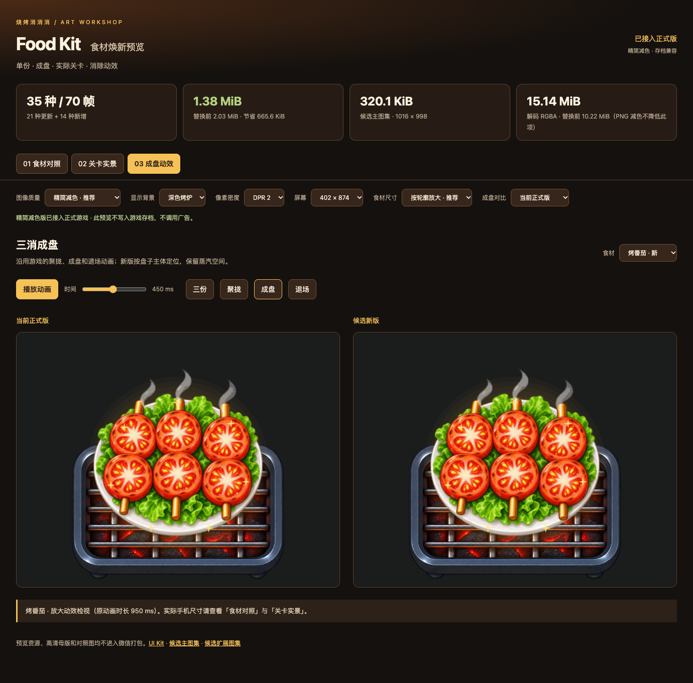
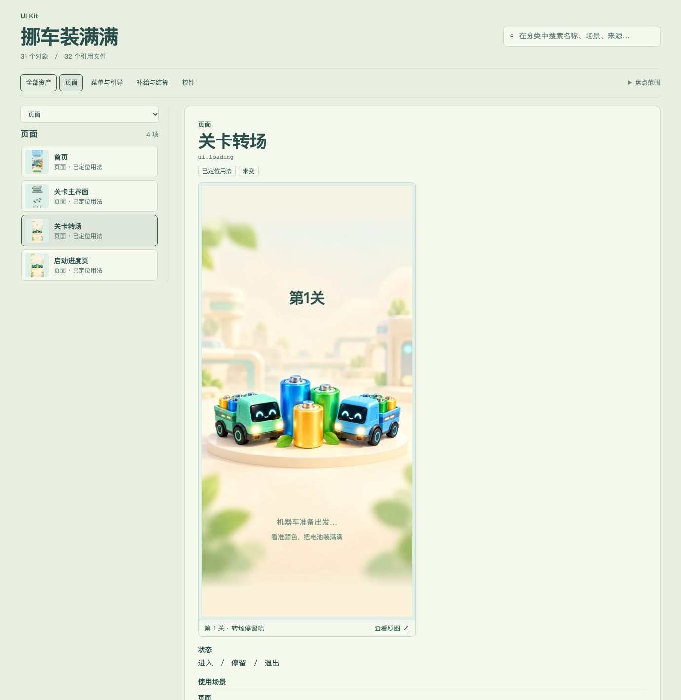
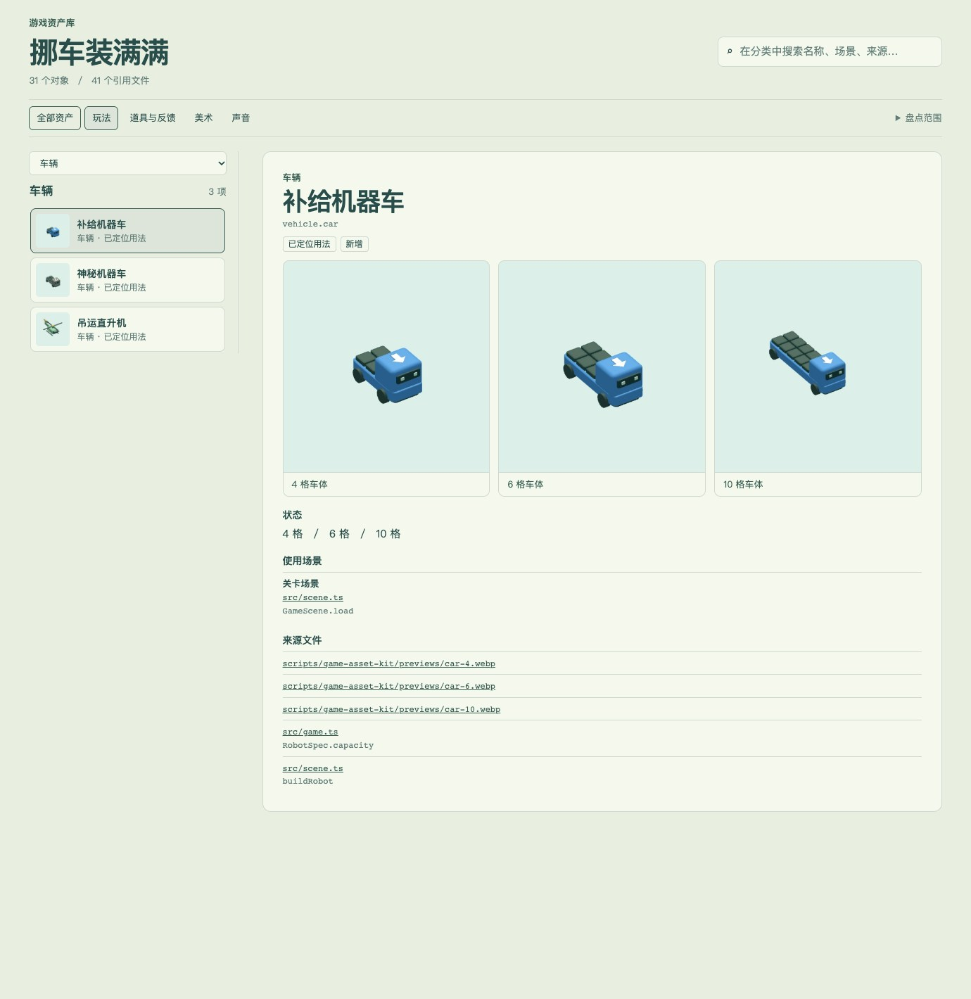
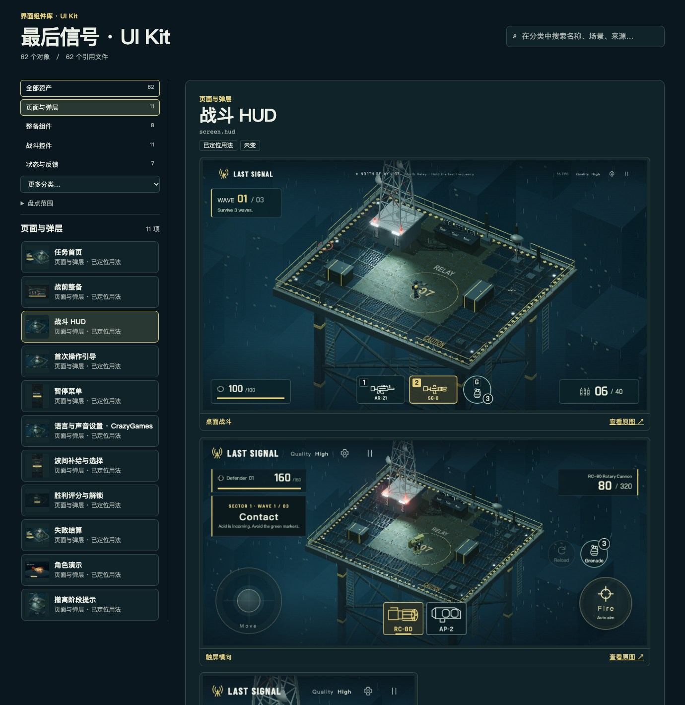
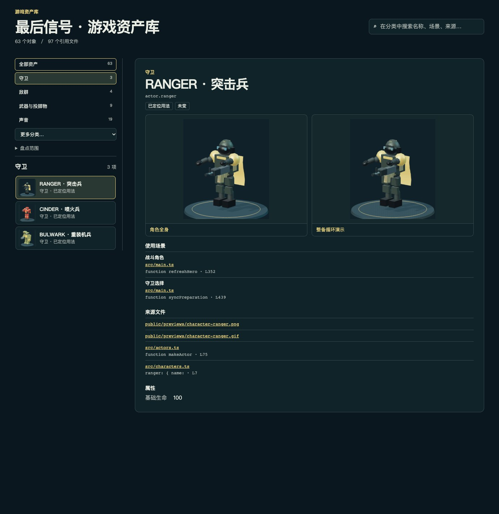

# 🎮 Sonic GPT Skills

**我在实际项目中使用的 Codex Skill 合集，持续更新。**

𝕏 [关注我的 X 主页 · @sonic0828](https://x.com/sonic0828)

这里收录可以独立安装的 Skill。每个条目都有使用说明和真实项目的效果图。第一款面向小游戏开发，可以把散落在源码、图集和关卡配置里的素材整理成一套可查的工作台。

## 📚 1 个 Skill 一览

| Skill | 能做什么 | 入口 |
| --- | --- | --- |
| [游戏资产库提炼](#游戏资产库提炼) | 从游戏项目生成 UI Kit 或完整资产库，按玩家认识的对象查预览、状态、使用位置和原文件 | [查看效果与教程](skills/game-asset-kit/README.md) |

## 🚀 开始使用

在目标游戏的根目录运行以下命令，即可在该项目中首次安装。

```bash
git clone https://github.com/sonic0828/sonic-gpt-skills.git ../sonic-gpt-skills
mkdir -p .agents/skills
test ! -e .agents/skills/game-asset-kit && cp -R ../sonic-gpt-skills/skills/game-asset-kit .agents/skills/
```

已有合集副本时，可直接复制其中的 Skill 文件夹。安装后在游戏项目里新开一个 Codex 对话，发送「$game-asset-kit 给这个游戏搭一套资产库」。只想整理界面时，把最后一句换成「提炼这个游戏的 UI Kit」。[安装说明与随包试跑](skills/game-asset-kit/README.md)

---

## 🖼️ 效果展示

### 游戏资产库提炼

选中一个对象，就能从它在游戏里的样子查到背后的文件。例如，查「烤番茄」能同时看到炉上的单份和三消后的成盘，还能找到使用它的关卡。下次更新同一项目时，可以继续沿用已整理的名称和备注。

#### 先看图选布局

六张图来自六个游戏。图上标有编号、适合的游戏品类和查找方式。首次建库时回复「选 03」即可，也可以说「你来选」。点击总览可打开每款的大图。

[](skills/game-asset-kit/references/layouts.md)

#### 实际案例

以下十张图均可点击放大。前两张展示从游戏源码提炼出的资产库，接下来分别看四个游戏的界面与资产。

| 小球分类 · 一句话盲测 | 烧烤消消消 · 同一件食材的两种状态 |
| --- | --- |
| [](previews/game-asset-kit/generated-ball-sort.png) | [](previews/game-asset-kit/generated-bbq.png) |
| 在没有现成 Kit 的项目里，只说「给这个游戏搭一套资产库」，得到 213 个对象。其中包括 120 个普通关和 23 个特殊关的开局。图中是第 5 关之后的特殊挑战。[图册配置](previews/game-asset-kit/ball-sort-presentation.json) | 从正式图集提炼出 35 种食材。「烤番茄」的单份和成盘各自保留帧名、像素区域与使用位置，可追到第 20 关。[对照台配置](previews/game-asset-kit/bbq-presentation.json) |

| 货柜收纳消 · UI 库 | 货柜收纳消 · 商品库 |
| --- | --- |
| [](skills/game-asset-kit/references/cases/source-goods-ui.png) | [](skills/game-asset-kit/references/cases/source-goods-shelf.png) |
| 在原游戏的组件库里，可按分类查看按钮，切换设置开关的状态，再从卡片进入使用它的页面。 | 在原游戏的 Goods Kit 里，把牛奶和候选苹果放到同一货架，前后排的遮挡、落脚点可以直接比较。 |

| 烧烤消消消 · UI 库 | 烧烤消消消 · 食材库 |
| --- | --- |
| [](skills/game-asset-kit/references/cases/source-bbq-ui.png) | [](skills/game-asset-kit/references/cases/source-bbq-food.png) |
| 原游戏的 UI Kit 并排展示高清参考、空白底图和代码绘制效果。从「开摊」按钮能看清哪些部分来自图片、哪些文字由代码绘制。 | 原游戏的 Food Kit 可以拖动时间轴。图中停在 450 ms，便于核对成盘后的盘身、蒸汽与炉位。 |

| 挪车装满满 · UI 库 | 挪车装满满 · 资产库 |
| --- | --- |
| [](previews/game-asset-kit/cargo-ui.jpg) | [](previews/game-asset-kit/cargo-library.jpg) |
| 从「页面」进入关卡转场，能在竖屏画面中读到关卡号，并找到负责绘制转场的代码。 | 选中「补给机器车」，可并排看 4 格、6 格、10 格车体，并沿条目查找使用位置。 |

| 最后信号 · UI 库 | 最后信号 · 资产库 |
| --- | --- |
| [](previews/game-asset-kit/signal-ui.jpg) | [](previews/game-asset-kit/signal-library.jpg) |
| 62 个界面对象涵盖页面、弹层、整备组件等。战斗 HUD 条目可逐张查看桌面、触屏横向和触屏纵向画面。 | 在 63 个资产对象中选中 RANGER，可查看角色全身与整备循环，并定位到使用它的游戏文件。 |

## ✨ 持续更新

后续会把实际项目里反复用到的工作流程整理成新的 Skill。每款准备好使用说明和可复现的案例后，都会加入首页一览。已有 Skill 的改进也会同步更新到对应教程。

## 👋 关于作者

我是 **Sonic**，这个合集的维护者。我把自己做小游戏时用过的工具和方法整理在这里，方便大家拿到自己的项目里试用。欢迎来交流使用体验，也欢迎分享你的游戏工作台。[X 主页 · @sonic0828](https://x.com/sonic0828)
