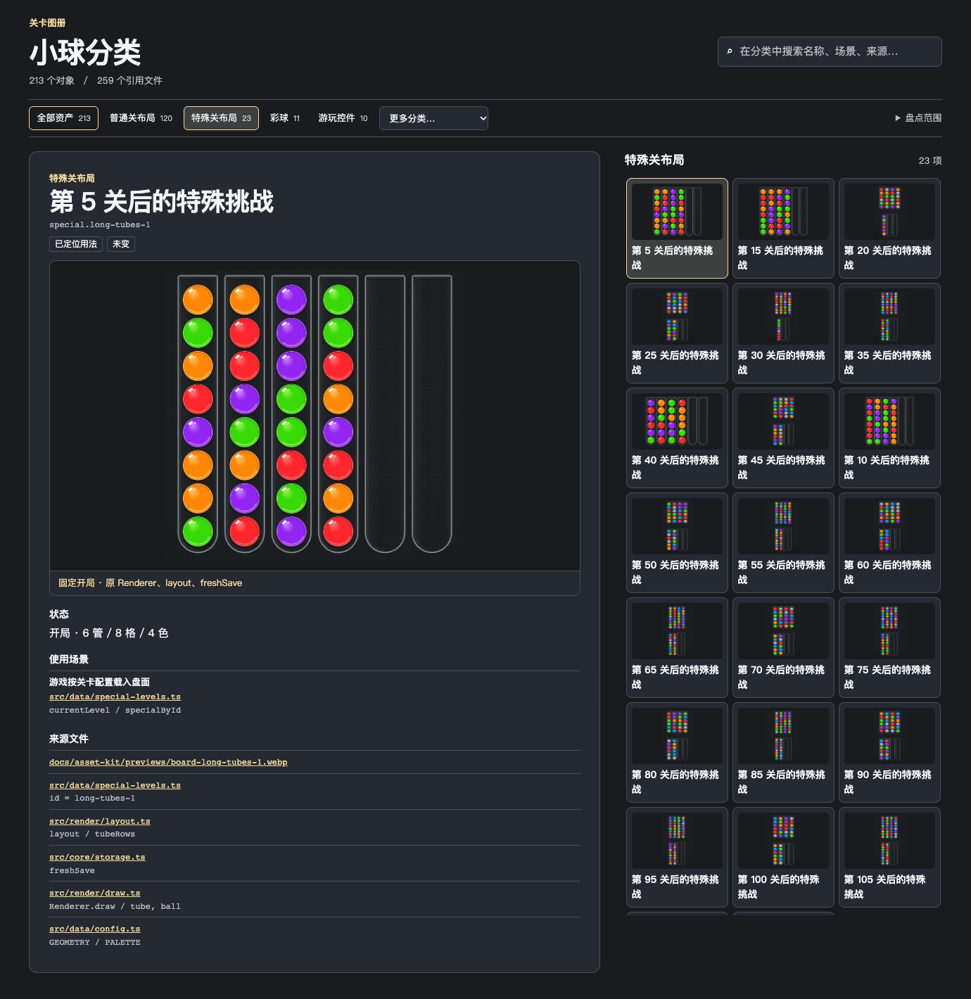
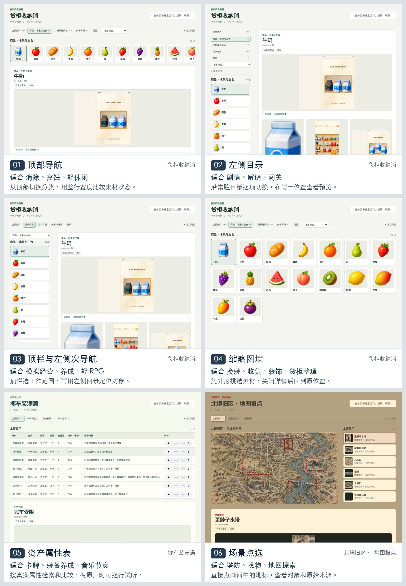
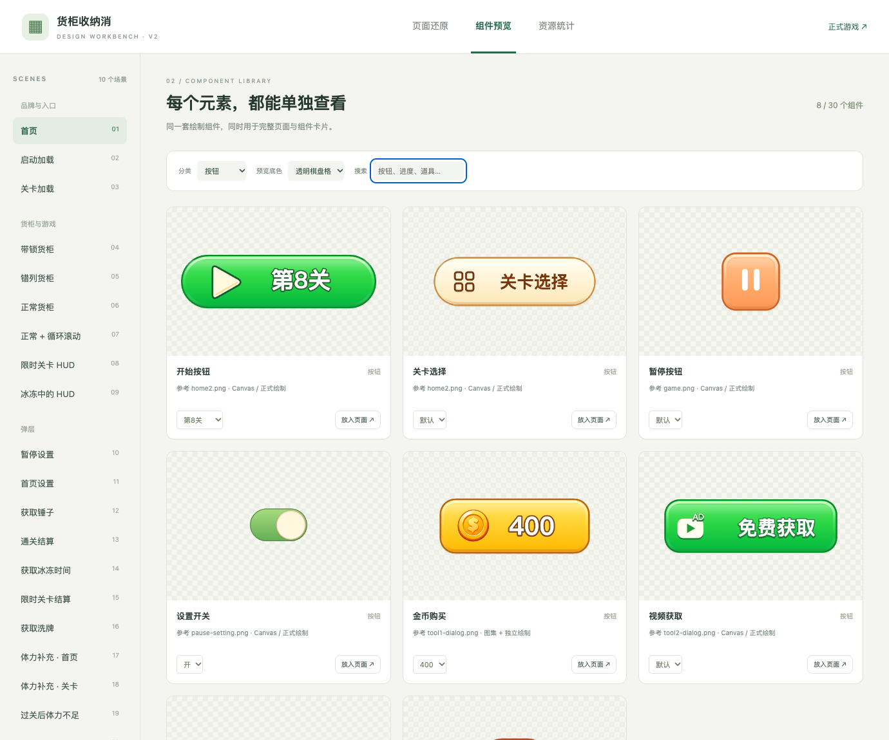
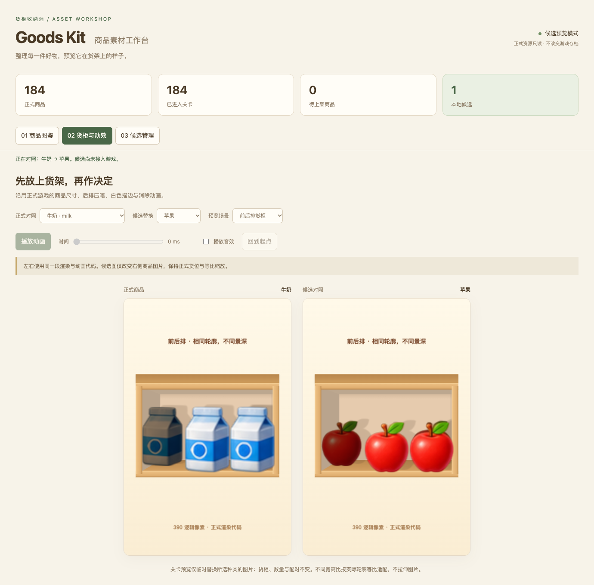

# Sonic GPT Skills

第一个可独立安装的 Skill 是 **游戏资产库提炼**。在自己的游戏项目里说一句话，就能得到本地资产工作台，按名称查组件、看素材在游戏里的样子，再回到绘制函数、图集区域或关卡配置。

## 实际生成的工作台

### 小球分类 · 一句话盲测

> 用这个 Skill 给这个游戏搭一套资产库。

在没有现成 Kit 的小球分类项目里，仅提供这条指令。工作台收录 213 个对象，类别包括彩球、试管、道具、动效和关卡布局。新版关卡图册沿用游戏的深灰棋盘底色，放大第 5 关之后的特殊挑战，可看清 6 管、8 格和 4 色。固定开局图由游戏自己的渲染器绘制，详情能追到特殊关卡配置。同一次提炼还收录了 120 个普通关与 23 个特殊关的开局。[查看图册展示配置](previews/game-asset-kit/ball-sort-presentation.json)

### 烧烤消消消 · 同一件食材的两种状态

回归时从正式图集提炼了 35 种食材。搜索「烤番茄」可以看到单份与成盘，并查到第 20 关等实际使用位置。在炭棕色对照台上从缩略图条选择食材，即可并排观察两种状态；两张预览各自保留帧名和像素区域。[查看食材展示配置](previews/game-asset-kit/bbq-presentation.json)

## 示例指令

| 需求 | 在游戏项目里发送 |
| --- | --- |
| 只整理界面 | `$game-asset-kit 提炼这个游戏的 UI Kit。` |
| 盘点游戏对象 | `$game-asset-kit 给这个游戏搭一套资产库。` |
| 继续上次的整理 | `$game-asset-kit 游戏里新增了几件道具，更新一下资产库。` |

**交付内容**包括可直接打开的 `index.html`、可更新的盘点输入 `catalog.json` 和保留人工命名与备注的 `manifest.json`。同一货柜游戏的两次实际调用分别得到 78 个 UI 条目和 494 个完整库条目，后者包括 184 件正式商品及其关卡位置。已在隔离副本验证素材改图、改名、新增、失联和退出盘点。

## 先看图选布局

前四款使用同一货柜游戏、商品和配色。05 展示真实音效库的属性检索与试听，06 展示探索地图的五处可点地标。[放大查看六款单图](skills/game-asset-kit/references/layouts.md)

在对话里说「选 02，颜色沿用游戏」「你来选，方便我找商品」或「把已有库换成 04」即可。

只需复制一个 Skill 文件夹。也可以先用随包的四张截图试跑，无需准备游戏源码。[安装、调用与四张图的试跑步骤](skills/game-asset-kit/README.md)

## 四个来源案例

这些图取自两个游戏在本 Skill 开发前已有的工作台。它们分别说明为什么要保留组件状态、参照格位、绘制来源和动画时间点。

| 货柜收纳消 · UI Kit | 货柜收纳消 · Goods Kit |
| --- | --- |
|  |  |
| 设置开关由 Canvas 绘制，可从组件卡片定位到设置页。 | 左右共用货架位置，观察前后排的脚底、遮挡和暗度。 |

| 烧烤消消消 · UI Kit | 烧烤消消消 · Food Kit |
| --- | --- |
|  |  |
| 开摊按钮并排展示高清稿、空白底图和代码绘字。 | 烤番茄在三消后 450 ms 成盘，蒸汽与盘身共用炉位。 |

完整工作台引用被分析项目的本地文件。除小球、烧烤和货柜案例外，属性表还用《挪车装满满》的 7 段音效验证了检索与试听，场景点选用《北境旧区·地图报点》的 5 处地标验证了画面定位。
