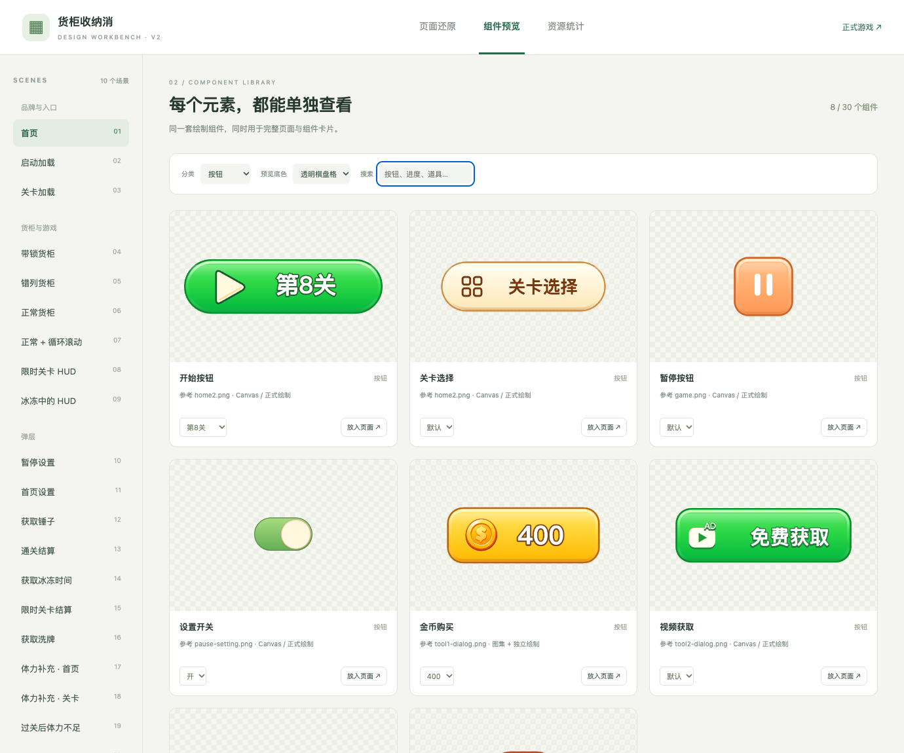
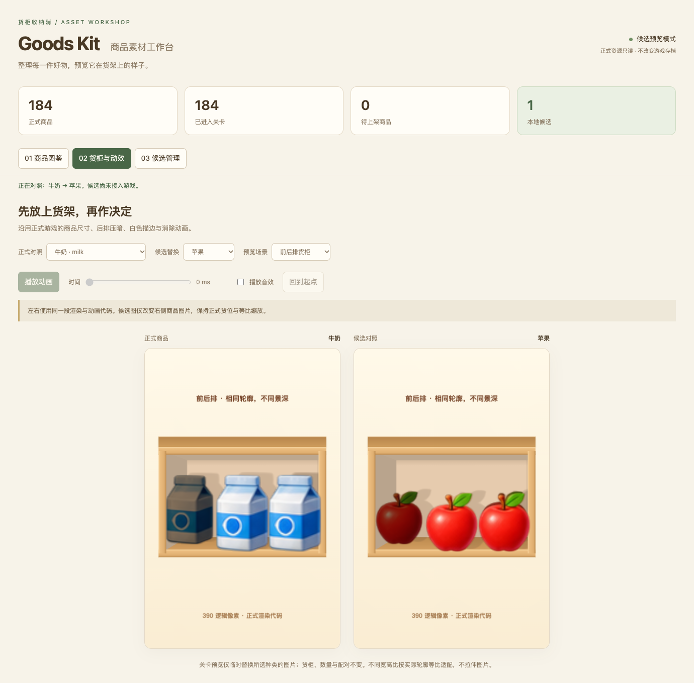
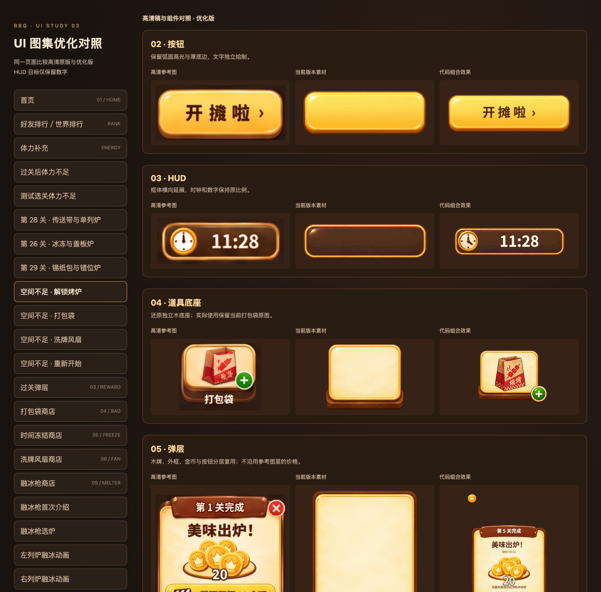
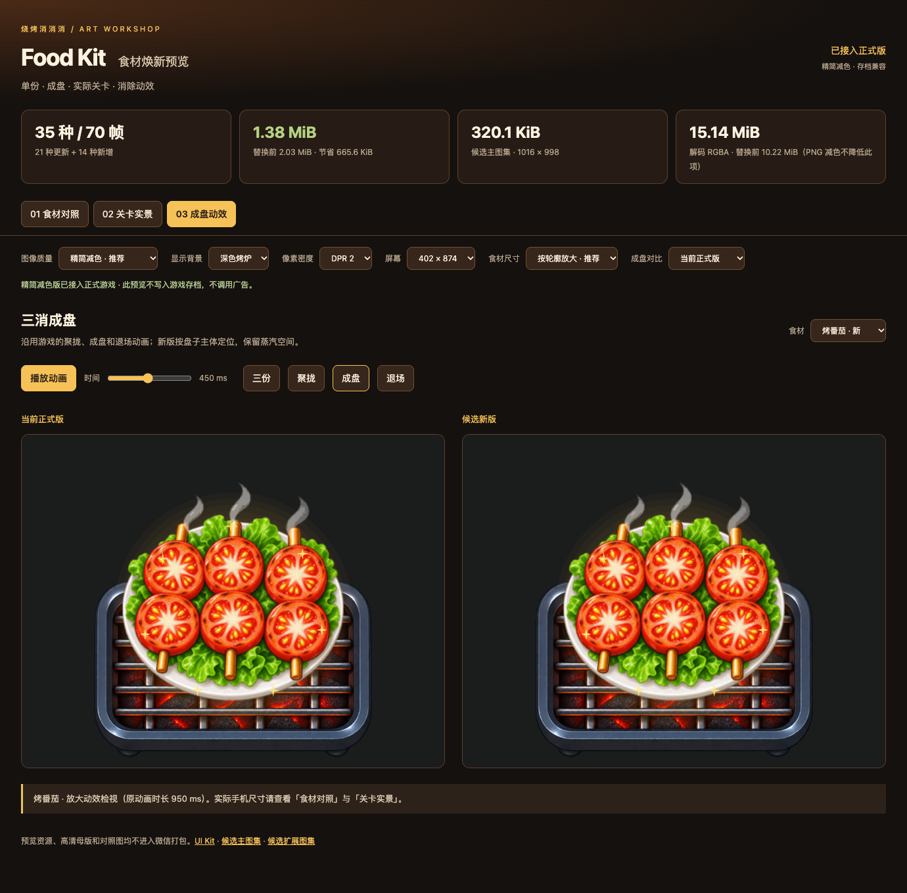

# 游戏资产库提炼 · Game Asset Kit

在游戏项目里说「给这个游戏搭一套资产库」，就能按玩家认识的对象查素材。选中一件道具，可以对照图集里的不同状态、查看它在哪几关出现，并打开原文件。只关心界面时，可以单独提炼 UI Kit。

## 安装

将本目录完整复制到目标游戏的 `.agents/skills/game-asset-kit/`，在该游戏项目里新开 Codex 对话即可。已有合集副本时，在合集根目录执行以下命令，将第一行改为自己的游戏路径。

```sh
GAME="../my-game"
mkdir -p "$GAME/.agents/skills"
test ! -e "$GAME/.agents/skills/game-asset-kit" && cp -R skills/game-asset-kit "$GAME/.agents/skills/"
```

如需在多个项目中使用，可把同一个文件夹复制到个人的 `~/.agents/skills/`。构建需要 Python 3.9 或更高版本，使用标准库。工作台可在桌面浏览器中直接打开，图片与音视频从本地游戏项目读取。Windows 下将项目和输出放在同一卷以保留相对链接。

## 从自己的游戏调用

| 想做的事 | 可以直接发送 |
| --- | --- |
| 提炼界面 | `$game-asset-kit 提炼这个游戏的 UI Kit。` |
| 建立资产库 | `$game-asset-kit 给这个游戏搭一套资产库。` |
| 更新已有结果 | `$game-asset-kit 游戏里新增了几件道具，更新一下资产库。` |

Agent 会沿着游戏入口查绘制和使用位置，再核对素材目录。UI Kit 收录页面、弹窗、HUD 和组件。完整资产库还会纳入有依据的玩法对象、场景或音频。覆盖说明记录实际检查的范围。只有截图或录像时，工作台保留画面位置、裁切区域或时间点。

打开 Agent 返回的 **index.html**。选择分类后可搜索名称、状态、场景或文件路径，点开对象即可查看预览与证据。工作台沿用游戏画面的用色，按内容采用图册、状态对照或检索目录。点击路径可打开原文件，旁边的符号、节点或区域可用于定位。程序绘制的对象可以只显示源码与使用位置。

| 输出文件 | 用途 |
| --- | --- |
| `index.html` | 本地工作台。保持输出与游戏目录的相对位置，移动后可重新构建。 |
| `presentation.json` | 展示配置。保存取色依据、布局、首屏对象与预览顺序，供后续重建复用。 |
| `catalog.json` | 本轮提炼输入。保留这个文件以继续更新或复现同一次盘点。 |
| `manifest.json` | 合并后的条目、人工字段、文件指纹和更新状态。 |

**保留自己的整理。** 在 `manifest.json` 的相应条目填写 `manual.name` 或 `manual.note`，再让 Agent 更新。可确认身份的改名和移动沿用同一 ID。旧文件消失会显示「来源缺失」，退出盘点的条目保留备注。工作台按引用文件的内容判断变更，共用图集有调整时，关联条目都会提示复核。[完整清单格式](references/catalog.md)

## 用随包截图试跑

下面的命令可在干净目录验证安装。四张实际案例图就是输入，输出包含四个有裁切坐标的画面条目。将终端切到已安装的 `game-asset-kit` 文件夹，再执行以下命令。

```sh
SKILL_DIR="$PWD"
GAME="$SKILL_DIR/references/cases"
OUT="$(mktemp -d)"
cp "$SKILL_DIR/references/visual-example.json" "$OUT/catalog.json"
python3 "$SKILL_DIR/scripts/kit.py" build --project "$GAME" --out "$OUT"
python3 "$SKILL_DIR/scripts/kit.py" check --project "$GAME" --out "$OUT"
```

双击终端输出路径中的 `index.html`，搜索「烤番茄」。可以查看 450 ms 的成盘画面，再点来源文件打开整张截图。对自己的项目执行相同命令时，把 `GAME` 换成游戏根目录，`OUT` 换成含有该游戏 `catalog.json` 的开发目录。

## 四个来源案例

以下图片来自两个游戏原有的开发工作台。每个案例说明一种值得保留的证据。

### 货柜收纳消 · 设置开关

看中间卡片的「开」状态和「放入页面」入口。`js/game/ui-skin.js` 的 `toggle` 绘制开关，`settingsDialog` 在首页设置与暂停面板复用它，音效、音乐和振动读取各自的开关值。图为 `docs/evidence/ui-kit/components.png` 的原尺寸局部。



### 货柜收纳消 · 货架商品

看两列商品的脚底和后排暗度。左侧牛奶对应 `assets/goods/p1_001.png`，清单键为 `milk`，第 2 关的 s0 前排第 3 格就摆着牛奶。`dev/goods-preview.js` 的 `GoodsPreview.draw` 让苹果候选使用同一组格位。图取自 `docs/evidence/browser-goods-kit-shelf.png`。



### 烧烤消消消 · 开摊按钮

从左到右看高清参考、空白按钮底图和独立绘字后的组合。首页在 `js/view/renderer.js` 绑定 `start`，对照页在 `dev/ui-kit-compare.js` 调用同一套按钮绘制接口。截图取自「高清稿与组件对照」的优化档；此次也切换核对了无损档与高清档。



### 烧烤消消消 · 烤番茄

看 450 ms 时横盘、蒸汽与炉位的相对位置。`assets/atlas-extra.js` 把 `food:tomato` 和 `combo:tomato` 定位到 `packs/foods/atlas.png` 的不同区域。第 20 关包含番茄补盘，`BoardView.drawCombo` 使用成盘帧。图取自 Food Kit 的「成盘动效」。


