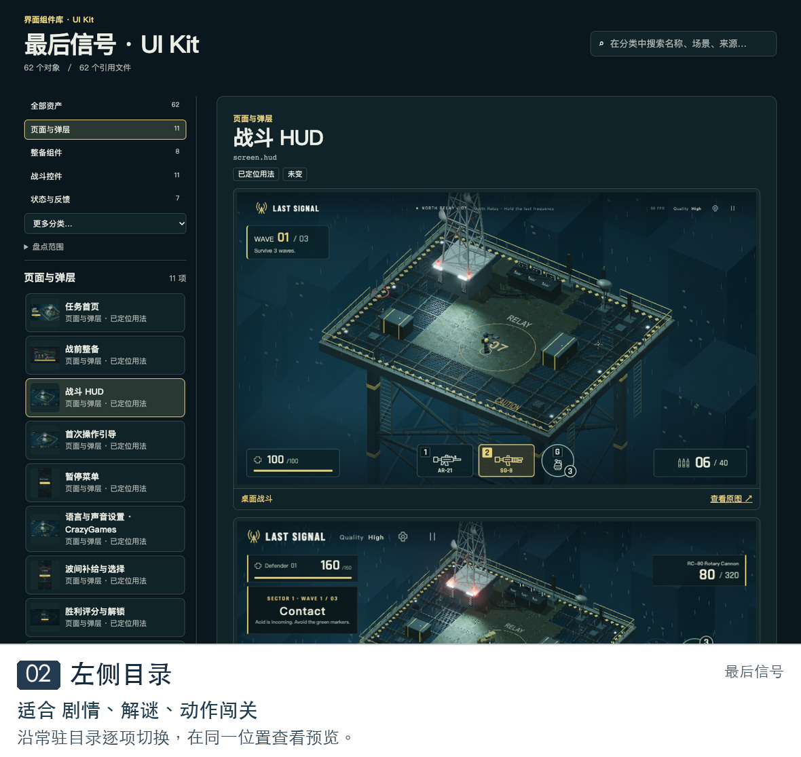
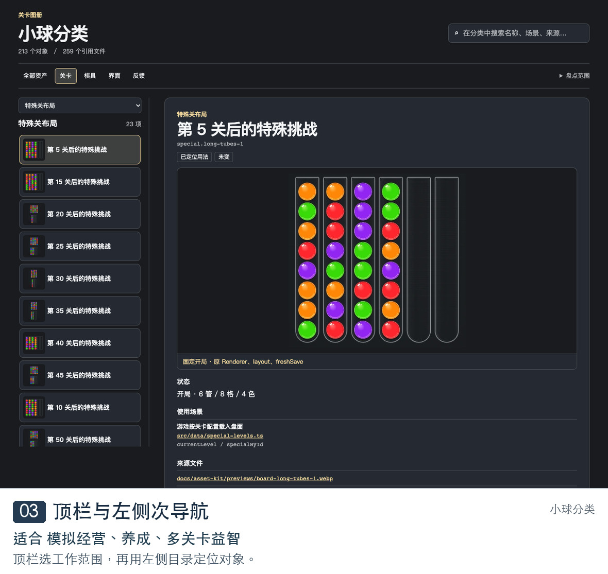
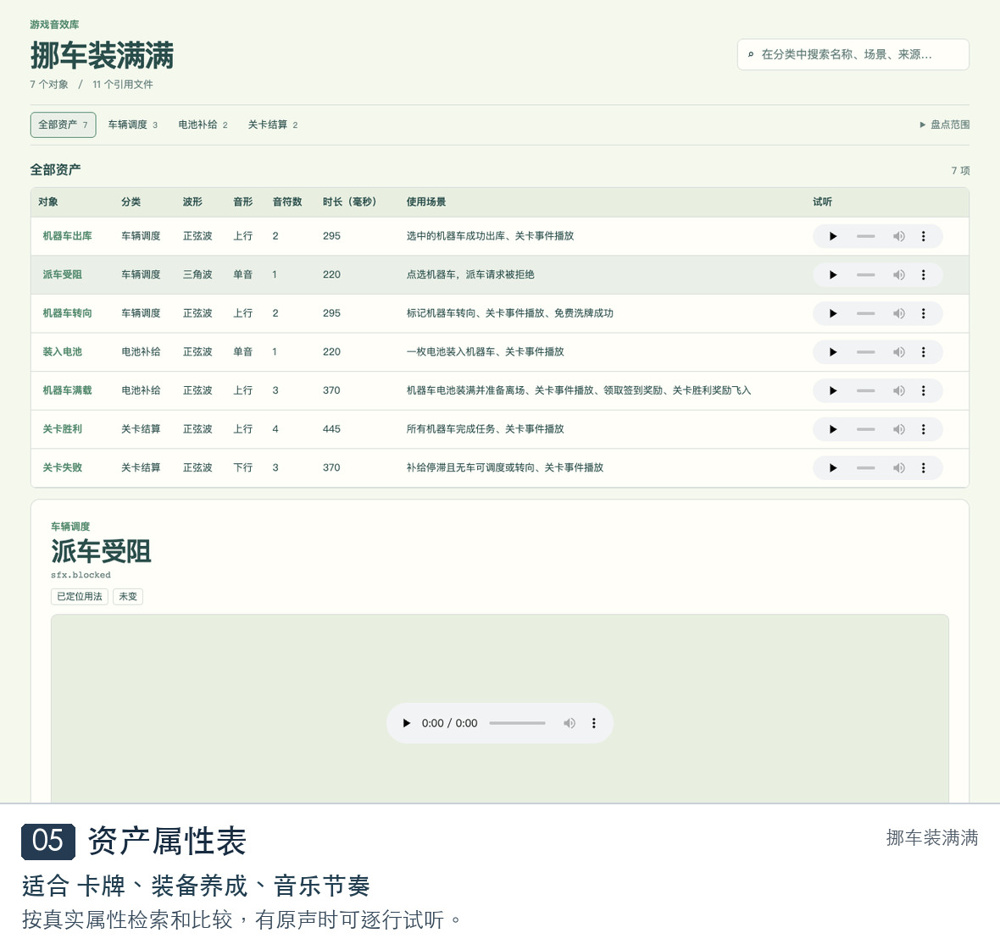

# 六款工作台布局

先看适用任务，再选编号。点击单图可查看大图。六款分别使用六个游戏的工作台实拍，保留各自的游戏配色。

## 01 · 顶部导航

**适合消除、烹饪、轻休闲。** 从顶部切换分类，用整行宽度比较素材状态。 图中游戏为烧烤消消消。

## 02 · 左侧目录

**适合剧情、解谜、动作闯关。** 沿常驻目录逐项切换，在同一位置查看预览。 图中游戏为最后信号。

## 03 · 顶栏与左侧次导航

**适合模拟经营、养成、多关卡益智。** 顶栏选工作范围，再用左侧目录定位对象。 图中游戏为小球分类。

## 04 · 缩略图墙

**适合换装、收集、装饰、货柜整理。** 凭外形挑选素材，关闭详情后回到原位置。 图中游戏为货柜收纳消。

## 05 · 资产属性表

**适合卡牌、装备养成、音乐节奏。** 按真实属性检索和比较，有原声时可逐行试听。 图中游戏为挪车装满满。

## 06 · 场景点选

**适合塔防、找物、地图探索。** 直接点画面中的地标，查看对象和原始来源。 图中游戏为北境旧区 · 地图报点。

